# Gene expression in NPM1-mutated vs NPM1-wild-type AML (Beat AML 2.0)

A learning and portfolio project: differential expression between NPM1-mutated and NPM1-wild-type acute myeloid leukaemia using Beat AML 2.0 RNA-seq counts, connected to menin inhibitor biology. The session-by-session log, with every number and decision, is in [LEARNING.md](LEARNING.md).

**Project web page:** a static site in `docs/` (overview, key figures, and a gene lookup for any gene), served by GitHub Pages once the repo is public. To preview it locally, run `python3 -m http.server --directory docs` and open http://localhost:8000.

## Summary

*To write: three to five sentences on the question, the cohort, the main result and what it means.*

## Background

*To write: NPM1 mutations in AML, the HOX/MEIS1 program, and why menin inhibitors target it.*

## Question and hypothesis

*To write: the question this project asks and what we expected to see.*

## Data

All data come from **Beat AML 2.0** (https://github.com/biodev/beataml2.0_data), shared under the [Creative Commons Attribution 4.0 licence (CC-BY-4.0)](https://creativecommons.org/licenses/by/4.0/). The data are by the Beat AML investigators and are used here unchanged, apart from the filtering and analysis described below; this project is not endorsed by them. Raw data are not stored in this repository; `scripts/01_download.R` fetches them.

Files used:

| File | Used for |
|---|---|
| `beataml_waves1to4_counts_dbgap.txt` | Raw RNA-seq read counts per gene (Ensembl 75, GRCh37) |
| `beataml_wv1to4_clinical.xlsx` | Diagnosis, NPM1 and FLT3-ITD calls, specimen type, sex, wave, fusions |
| `beataml_waves1to4_sample_mapping.xlsx` | Matching RNA and DNA sample IDs to patients |
| `beataml_wes_wv1to4_mutations_dbgap.txt` | Exome mutation calls (co-mutations within NPM1-mutated AML) |
| `beataml2_manuscript_vg_cts.xlsx` | Malignant cell-type scores (Bottomly et al. 2022, from van Galen et al. 2019 marker genes) |
| `beataml_probit_curve_fits_v4_dbgap.txt` | Ex vivo drug response (AUC per sample and drug) |
| `beataml_drug_families.xlsx` | Drug target families, for colouring the drug plots |

Please cite the Beat AML papers when using these data:

- Bottomly D, Long N, Schultz AR, et al. Integrative analysis of drug response and clinical outcome in acute myeloid leukemia. *Cancer Cell* 2022;40(8):850-864.e9. https://doi.org/10.1016/j.ccell.2022.07.002
- Tyner JW, Tognon CE, Bottomly D, et al. Functional genomic landscape of acute myeloid leukaemia. *Nature* 2018;562(7728):526-531. https://doi.org/10.1038/s41586-018-0623-z

**Replication cohort: TCGA-LAML** (Cancer Genome Atlas Research Network, *NEJM* 2013). Gene counts (STAR, GENCODE v36, GRCh38), clinical data and open "masked" mutation files come from the NCI Genomic Data Commons; the paper's curated mutation calls, cytogenetics and survival come from cBioPortal (study `laml_tcga_pub`); read coverage and splice junctions along FTO come from recount3 (Wilks et al. 2021). `scripts/08_tcga_replication.R` and `scripts/11_fto_locus.R` fetch them.

**Cohort.** AML only, sample taken at initial diagnosis, de novo AML only (no secondary or therapy-related AML), one sample per patient (the earliest). Acute promyelocytic leukaemia and KMT2A-fusion cases were excluded from the main comparison; the KMT2A-fusion cases are kept for a separate three-group plot. One sample was dropped in QC because its recorded sex didn't match its expression (possible sample swap). Final main cohort: **276 patients, 100 NPM1-mutated and 176 wild-type.** The step-by-step counts are in `results/cohort_flow.csv`.

## Methods

**Differential expression.** Genes with at least 10 reads in at least 100 samples were kept (19,398 genes). DESeq2 was fitted with the design `~ wave + specimen_type + sex + NPM1_status`, with NPM1 wild-type as the reference. `wave` is the Beat AML sequencing batch (three levels), `specimen_type` is bone marrow vs blood (leukapheresis counted as blood). Sex is in the model because NPM1-mutated AML is more common in women (64% vs 41% here). Fold changes were shrunk with apeglm; p-values come from the Wald test and were adjusted with Benjamini-Hochberg. A gene counts as changed at padj < 0.05 and |log2 fold change| > 1. A sensitivity model added FLT3-ITD to the design.

**Gene-set enrichment.** Genes were ranked by the DESeq2 Wald statistic. Male-specific chrY genes and XIST (26 genes) were removed first, because a sex-adjusted model still handles Y genes with near-zero counts in females badly. Preranked GSEA used fgsea (`fgseaMultilevel`, sets of 15 to 500 genes) on MSigDB Hallmark, GO Biological Process and the two Verhaak NPM1 sets (MSigDB 2026.1.Hs via msigdbr). FDR was corrected within each collection. Redundant GO terms were collapsed with `fgsea::collapsePathways`.

**Expression plots and subgroup analysis.** Expression values for plots are DESeq2 variance-stabilised (VST) counts. Within NPM1-mutated AML, a score from NEK10, FTO and USP44 (mean z-score) was split into two groups by k-means. The groups were compared with exome mutation calls, FLT3-ITD, and marker scores for the primitive and committed subtypes of Mer et al. (2021). A second sensitivity DESeq2 model replaced NPM1 status with a three-level group (wild-type, NPM1-high, NPM1-low): `~ wave + specimen_type + sex + group`.

**Cell maturity.** Bottomly et al. (2022) gave each Beat AML sample six malignant cell-type scores (HSC-like, Progenitor-like, GMP-like, Promono-like, Monocyte-like, cDC-like; the first principal component of the top 30 marker genes per type from van Galen et al. 2019). 270 of the 276 main-cohort samples have scores. A sensitivity DESeq2 model added two of them, `~ wave + specimen_type + sex + HSC_like + Monocyte_like + NPM1_status`, and was compared with the main design refitted on the same 270 samples. A model with all six scores was run as an upper bound only: the six scores together predict NPM1 status with AUC 0.93, so that model removes NPM1 biology along with maturity.

**Replication in TCGA-LAML.** The Beat AML cohort filters were applied in the same order (111 patients: 31 NPM1-mutated, 80 wild-type, plus 9 KMT2A-rearranged for the three-group plot). Genes were matched to Beat AML by Ensembl ID. DESeq2 used `~ sex + NPM1_status` (TCGA has no sequencing waves, and GDC gives every sample the same specimen type, so there is no bone marrow vs blood split to adjust for; sequencing plate was checked by PCA and left out). The signature score is the mean z-score of the Beat AML top 50 up genes minus that of the top 50 down genes (those present in TCGA), and its ROC AUC for NPM1 status has a DeLong 95% CI.

**Drug response, survival and the FTO locus.** Ex vivo drug AUCs were matched to the same specimen as the RNA-seq; for each drug tested in at least 20 samples per group, `auc ~ NPM1_status + Monocyte_like`, with Benjamini-Hochberg FDR across drugs. Overall survival used Kaplan-Meier curves and Cox models adjusted for age (and FLT3-ITD within NPM1-mutated AML); treatment varied too much to model, so survival is exploratory. For FTO, read coverage and splice junctions along the gene in TCGA-LAML were read from recount3 (GRCh38, GENCODE v26) and compared between NEK10/FTO/USP44-high and -low samples.

**NPM1 classifier.** A LASSO logistic regression (glmnet) predicts NPM1 status from a blind VST of the 276 main-cohort samples. Candidate genes pass the same low-count rule, have an Ensembl match in TCGA and exclude male-specific chrY genes and XIST (18,668 genes). Performance comes from nested cross-validation: an outer 5-fold split (stratified by NPM1, repeated 10 times) for testing, and inside each training set a 10-fold `cv.glmnet` that picks the penalty (lambda.1se). The final model, fitted the same way on all 276 samples, and a plain logistic regression on HOXA9 + CD34 were locked before TCGA was read, then tested once on the 111 TCGA main-cohort patients. TCGA counts went through Beat AML's own VST (its size-factor reference and dispersion trend), and each model gene was then rescaled so its mean and SD across TCGA match Beat AML's, which removes technical differences between the two pipelines without using any labels.

**Software.** R 4.6.1 on Ubuntu 24.04. DESeq2 1.52.0, apeglm 1.34.0, fgsea 1.38.0, msigdbr 26.1.1 (MSigDB 2026.1.Hs), BiocParallel 1.46.0, data.table 1.18.6.1, dplyr 1.2.1, tidyr 1.3.2, readxl 1.6.0, jsonlite 2.0.0, httr 1.4.9, ggplot2 4.0.3, ggrepel 0.9.8, patchwork 1.3.2, pheatmap 1.0.13, pROC 1.19.1, glmnet 5.1, survival 3.8-12, recount3 1.22.0, rtracklayer 1.72.0, GenomicRanges 1.64.0. Exact versions of these and every package they depend on are locked in `renv.lock`. Full `sessionInfo()` for each step is in `results/sessionInfo*.txt`. Random steps use seed 2026.

## Results

### NPM1-mutated and KMT2A-rearranged AML share high HOXA9 and MEIS1


HOXA9 and MEIS1 expression (VST, roughly log2) in de novo AML at diagnosis: NPM1-mutated (n = 100), KMT2A-rearranged (n = 24) and other AML (n = 176). Both menin-dependent groups sit at the same high level (median HOXA9 12.2 and 12.3, MEIS1 12.2 and 12.1), about 2 to 2.8 log2 units above other AML (Wilcoxon p < 1e-8). NPM1-mutated and KMT2A-rearranged don't differ (p = 0.42 and 0.40). Triangles are the two KMT2A-rearranged cases that also carry an NPM1 mutation. Some "other AML" cases are HOXA9-high too, without either lesion.

### Differential expression

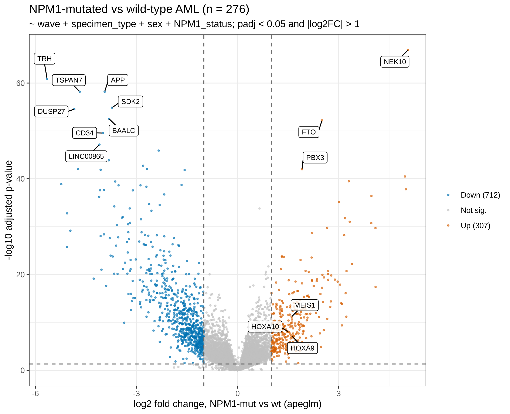

Each point is one of 19,398 genes: shrunken log2 fold change (NPM1-mutated vs wild-type) against -log10 adjusted p-value. 1,019 genes pass padj < 0.05 and |log2FC| > 1: 307 up and 712 down in NPM1-mutated AML. The positive controls all go the expected way: HOXA9 (+1.6), HOXA10 (+1.5), HOXB2 to HOXB9 (+1.4 to +3.1), MEIS1 (+1.6) and PBX3 (+1.9) up; CD34 down (-4.0). The two most significant up genes are NEK10 and FTO. Adding FLT3-ITD to the model keeps 42 of the top 50 genes in the top 50 (fold-change correlation 0.98).


The 50 most significant genes (VST, scaled per gene) across all 276 samples, clustered by gene and by sample. NPM1-mutated samples fall almost entirely into one branch. FLT3-ITD and sex don't line up with the branches. Most top genes are lower in NPM1-mutated AML, many of them stem and progenitor genes such as CD34 and BAALC.

### The published NPM1 signature is reproduced

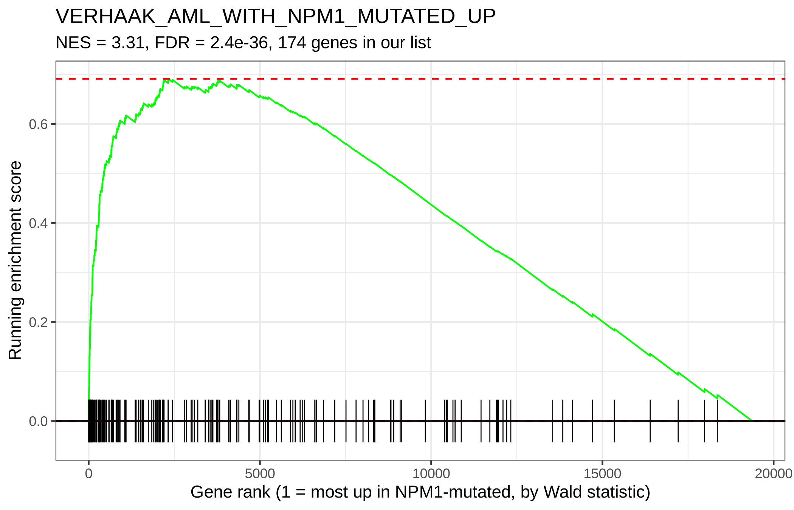

GSEA running enrichment score for VERHAAK_AML_WITH_NPM1_MUTATED_UP (174 genes in our list), a signature built from an independent microarray cohort in 2005. Most of the set sits at the top of our ranking: NES +3.31, FDR 2.4e-36. The matching DN set goes the other way (NES -3.76, FDR 1.4e-96). This is the strongest check that the pipeline works end to end.

### Pathways after collapsing redundant GO terms


Top 15 up and top 15 down GO Biological Process terms by NES, after `fgsea::collapsePathways` removed terms explained by a more significant overlapping term (468 terms at FDR < 0.05 down to 154). Up: embryonic skeletal morphogenesis and anterior/posterior pattern specification, whose leading edges are the HOXA and HOXB genes and PBX3, so this is the HOX program in GO's language. A group of cilium terms is also up, which we haven't explained yet. Down: antigen presentation (MHC class II) and cell-cycle terms. Dot size is genes in the set, colour is -log10 FDR.

### How much of the NPM1 signal is cell maturity?

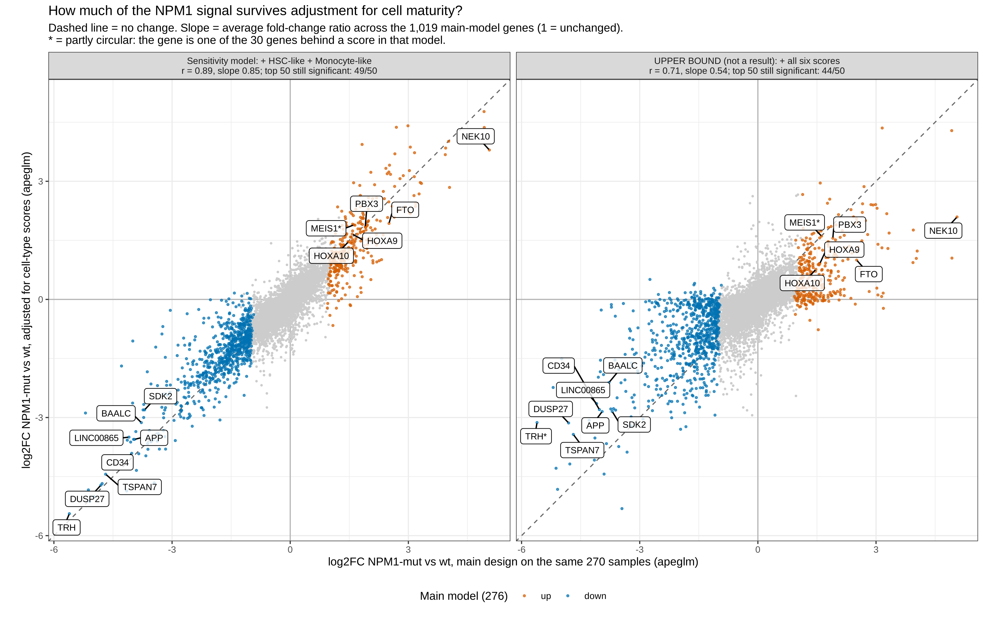

NPM1-mutated AML tends to look more mature than other AML (less stem-like, more promonocyte-like, usually CD34-negative), so some "NPM1 genes" could simply reflect where a sample sits on the stem-to-monocyte axis. Each point is a gene: its log2 fold change from the main design refitted on the 270 samples with cell-type scores (x) against the fold change after adding scores to the model (y). **Left, the sensitivity model** (+ HSC-like + Monocyte-like): fold changes correlate at 0.89 with the main design and are on average 0.85x its size; 49 of the top 50 genes stay significant (32 stay in the top 50). The core positive controls keep almost their full size: HOXA9 105%, HOXA10 99%, PBX3 97%, CD34 97% (all padj < 1e-6). MEIS1 rises to 117%, but MEIS1 is one of the 30 genes behind the HSC-like score, so that number is partly circular (marked \*). **Right, all six scores: an upper bound, not a result.** The six scores together predict NPM1 status with AUC 0.93, so this model strips out real NPM1 biology along with maturity; it shows the most that cell type could possibly explain. Even here every core control survives, though smaller (HOXA9 58%, CD34 70% of the main-design size). So cell maturity is a real influence, but it explains only a small part of the NPM1 signal. One caution: the NPM1 mutation itself pushes cells towards a more mature state, so maturity is partly a consequence of NPM1, and adjusting for it can remove real signal (CD34 is the clearest case).

### Replication in TCGA-LAML

TCGA-LAML is an independent cohort: a different centre, sequencing pipeline and genome build (GRCh38, GENCODE v36). The same cohort filters give 111 patients (31 NPM1-mutated, 80 wild-type) plus 9 KMT2A-rearranged cases. 18,693 of the 19,398 Beat AML genes have a TCGA match by Ensembl ID.

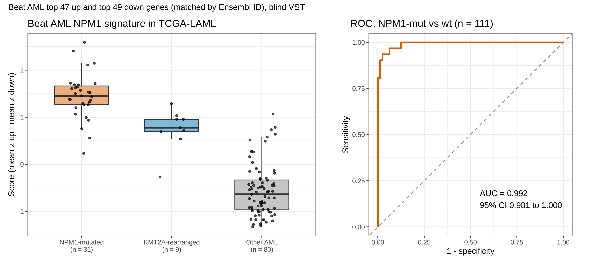

A signature score built only from Beat AML (mean z-score of its 50 most significant up genes minus its 50 most significant down genes; 47 and 49 of them exist in TCGA), computed for every TCGA sample. Left: NPM1-mutated AML scores high (median about 1.5) and other AML low (about -0.6). KMT2A-rearranged AML sits in between (about 0.8): it shares the HOX "up" half of the signature but not the "down" half (CD34, BAALC and other stem genes). Right: the score separates NPM1-mutated from wild-type with **ROC AUC 0.992 (95% CI 0.981 to 1.000)**. Nothing about TCGA was used to pick the genes, so this is a fair out-of-cohort test. It shows our signature is the known NPM1 signature, not something new.

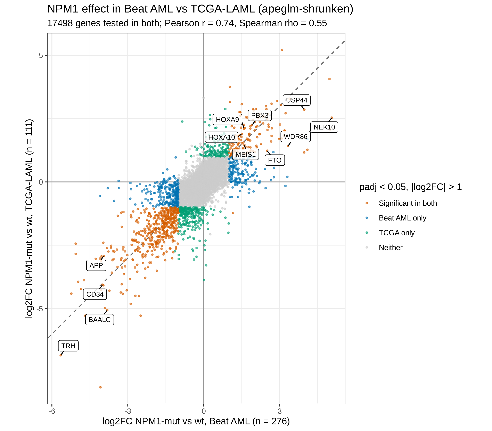

Shrunken log2 fold change (NPM1-mutated vs wild-type) in Beat AML (x) and TCGA (y) for the 17,498 genes tested in both; DESeq2 in TCGA used `~ sex + NPM1_status`. Pearson r is 0.74 across all of them and 0.84 across Beat AML's significant genes (most genes barely change in either cohort, and their noise doesn't correlate). 95% of Beat AML's 967 significant genes that TCGA tested go the same way there; 562 are significant in both cohorts and only one (BEGAIN) goes the opposite way. 48 of the 49 testable top-50 genes are significant again. Every positive control passes in TCGA with a similar fold change (HOXA9 +2.09, HOXA10 +1.90, MEIS1 +1.46, PBX3 +2.25, CD34 -4.06), and so do the two Verhaak gene sets (NES +3.79 and -3.80). Adding FLT3-ITD to the model keeps 46 of the top 50 in the top 50.

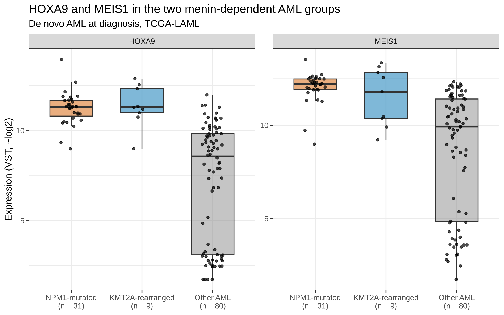

HOXA9 and MEIS1 (VST) in TCGA: NPM1-mutated (n = 31), KMT2A-rearranged (n = 9) and other AML (n = 80). The Beat AML picture comes back: the two menin-dependent groups sit at the same high level (median HOXA9 11.3 and 11.3, MEIS1 12.2 and 11.8; NPM1-mutated vs KMT2A-rearranged p = 0.66 and 0.75), 1.9 to 2.8 units above other AML (Wilcoxon p from 4e-12 to 0.008). Inside TCGA's NPM1-mutated AML, NEK10, FTO and USP44 again rise and fall together (Spearman 0.72 to 0.76) and their high samples are again primitive-like, but the high group is smaller: 6 of 31 (19%), against 37 of 100 in Beat AML.

### A known subgroup inside NPM1-mutated AML

More than a third of NPM1-mutated samples (37 of 100) have high NEK10, FTO and USP44 (two-cluster k-means on the mean z-score of the three genes; WDR86, an early fourth member, was dropped because it tracks FLT3-ITD instead). This group **matches two published NPM1 subgroups**; it is not a new discovery.

- **Mer et al. (2021), primitive vs committed subtypes.** Their primitive markers are all higher in our high group and their committed markers all lower.
- **Arza-Apalategi et al. (2023), IFEX9-high.** They showed that "high FTO" in about a third of NPM1-mutated AML is really an intragenic lncRNA, IFEX9, linked to FLT3-ITD, TET2, IDH2 and an immature profile. Our high group is enriched for TET2 (33% vs 11%) and IDH2 (39% vs 13%), leans towards FLT3-ITD (51% vs 35%, not significant), and holds 11 of the 15 samples with NPM1 + FLT3-ITD + TET2 or IDH2.
- **The "FTO" rise is IFEX9, not FTO itself** (TCGA-LAML read coverage, next section). Beat AML's gene-level counts can't separate the two: Ensembl 75 files IFEX9 as one of FTO's own transcripts (FTO-007, ENST00000472835), so its reads are counted as FTO.

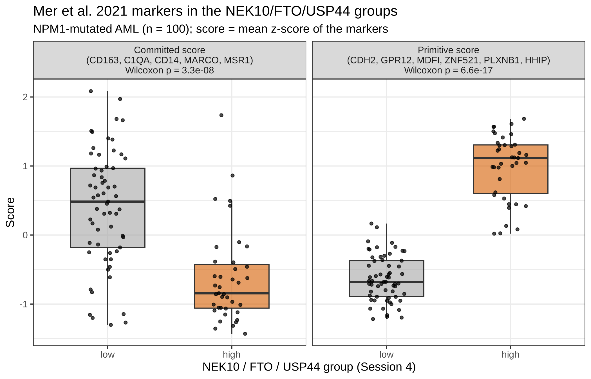

Primitive score (mean z-score of CDH2, GPR12, MDFI, ZNF521, PLXNB1, HHIP) and committed score (CD163, C1QA, CD14, MARCO, MSR1), the marker genes of Mer et al. (2021), in the NEK10/FTO/USP44-low (n = 63) and -high (n = 37) groups. The high group is primitive-like (Wilcoxon p = 2e-16) and the low group committed-like (p = 9e-7). The primitive score correlates with the NEK10/FTO/USP44 score at 0.90 (Spearman), and 32 of 37 high samples look primitive. The markers come from a different cohort and were picked by a different group, which is why the match is meaningful, though both scores are measured on the same RNA-seq data.

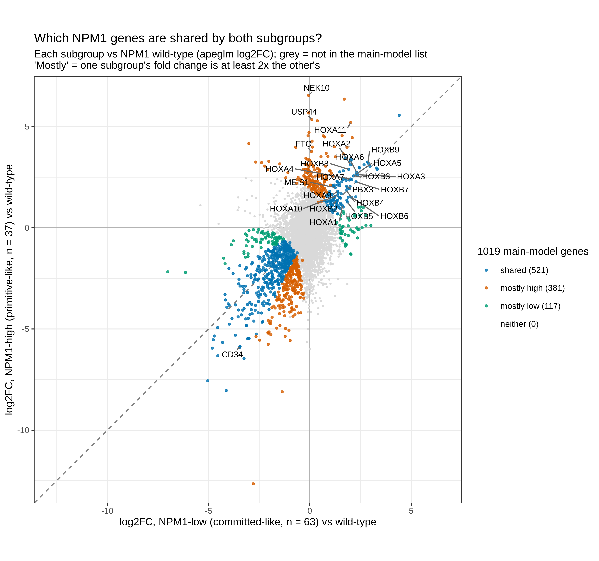

Log2 fold change vs NPM1 wild-type for the primitive-like (y) and committed-like (x) subgroups, from a sensitivity DESeq2 model with a three-level group. Coloured points are the 1,019 main-model genes. HOXA9, HOXA10, MEIS1 and PBX3 are up and CD34 down in both subgroups (all padj < 1e-4), and the HOX genes sit near the diagonal: the HOX program is shared by NPM1-mutated AML as a whole. NEK10, USP44 and FTO rise only in the primitive-like group. Of the 1,019 genes, 521 change about equally in both subgroups, 381 mostly in the primitive-like group and 117 mostly in the committed-like group (one subgroup's fold change at least 2x the other's).

### Is it FTO, or a transcript inside FTO?

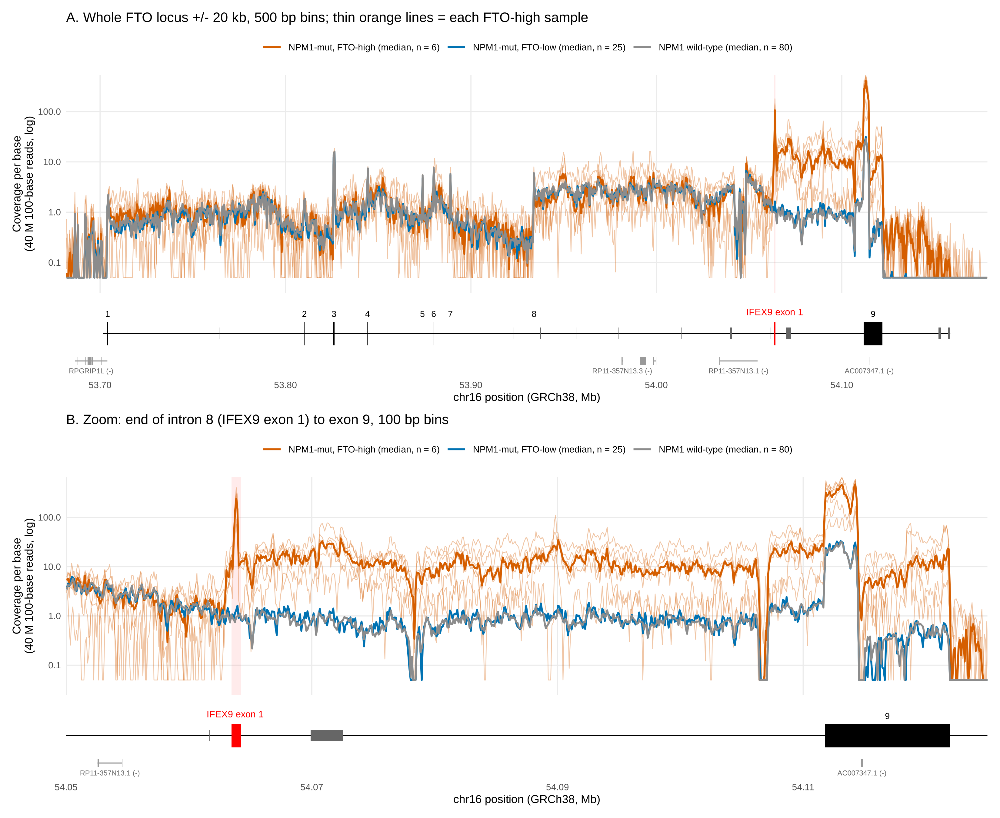

Read coverage along FTO (GRCh38, GENCODE v26, from recount3) in TCGA-LAML, scaled to 40 million 100-base reads: median of the 6 NPM1-mutated NEK10/FTO/USP44-high samples (orange, each sample also drawn thin), the 25 low samples (blue) and the 80 NPM1 wild-type samples (grey). FTO exons 1 to 8 look the same in all three groups. In the high group coverage jumps at IFEX9 exon 1, a small exon deep in FTO intron 8 (mean coverage 238 vs 4 in the low group; coordinates from Arza-Apalategi et al. 2023, checked against their qPCR primers), stays raised along the rest of intron 8, and lifts FTO exon 9 about 12-fold (81 vs 6.5). In every high sample, reads splice from IFEX9 exon 1 onto FTO exon 9 (61 to 434 reads per sample, vs at most 18 in the low samples), and onto several intron-8 acceptors that aren't in the annotation. The canonical FTO junctions (exon 1 to 2, ..., 8 to 9) are not higher in the high group. So the "high FTO" signal comes from a transcript that starts inside FTO and shares only its last exon: IFEX9, as Arza-Apalategi et al. reported. Exon 9 is also the part of FTO that gene-level counts are dominated by (10.2 of 11.4 kb of exon), which is why a gene-level count reads it as "FTO is up". Six high samples is a small group, so the per-sample plots (`figures/11_fto_coverage_per_sample.png`, `figures/11_fto_key_features.png`) matter as much as the tests: every one of the six shows the same pattern, and none of the 25 low samples does.

### Ex vivo drug response


Beat AML tested each sample's leukaemia cells against a drug panel and summarised each dose-response curve as an AUC (lower = more sensitive). Drug results were matched to the same specimen used for RNA-seq (211 of 276 main-cohort samples; 206 also have a monocyte-like score and form the analysis set). For each of 123 drugs with at least 20 tested samples per group, a linear model of AUC on NPM1 status plus the monocyte-like cell-type score gives the AUC difference (x) and a Benjamini-Hochberg FDR across drugs (y). No drug passes FDR 0.05; most of the leaning is towards NPM1-mutated cells being a bit more sensitive, led by kinase inhibitors (SNS-032, JNJ-7706621, FDR 0.08 to 0.09). No menin inhibitor (revumenib, ziftomenib or others) or DOT1L inhibitor is in the Beat AML panel, so the menin hypothesis can't be tested with these data.

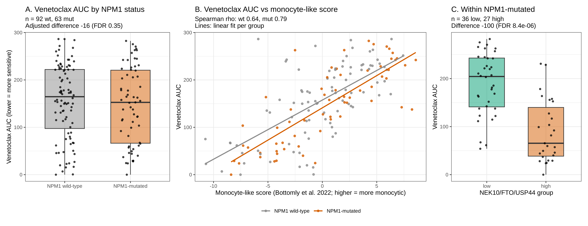

Venetoclax (BCL-2 inhibitor). A: no clear difference between NPM1-mutated and wild-type samples (adjusted difference -16, FDR 0.35). B: venetoclax AUC rises steeply with the monocyte-like score in both groups (Spearman 0.64 and 0.79): monocytic AML cells rely on MCL-1 rather than BCL-2 and resist venetoclax (Pei et al. 2020; Zhang et al. 2020). C: inside NPM1-mutated AML, the primitive-like NEK10/FTO/USP44-high group is far more sensitive than the committed-like group (median AUC 65 vs 204, FDR 8e-6), and about half of that gap remains after adjusting for the monocyte-like score. Mer et al. (2021) linked the primitive subtype to sorafenib, sunitinib and quizartinib sensitivity in an earlier Beat AML release; here those three lean the same way at most weakly (FDR 0.32 to 0.99).

### Survival (exploratory)

Treatment varied a lot across Beat AML patients (intensive chemotherapy, azacitidine or decitabine, trial drugs, transplant or not) and we can't model that, so these results are exploratory. Overall survival in Beat AML is counted from study inclusion, which for every main-cohort patient is the day of the diagnostic sample (within 3 days); patients alive at last contact are censored. 275 of 276 patients have follow-up (133 deaths; median follow-up 35 months).

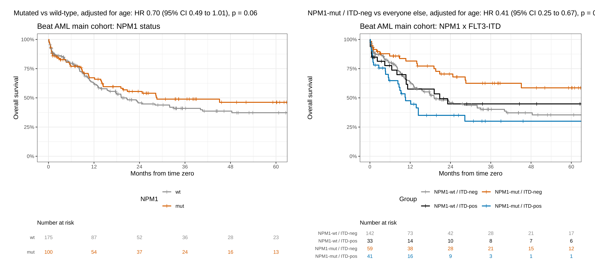

NPM1-mutated vs wild-type, adjusted for age: HR 0.70 (95% CI 0.49 to 1.01). The benefit sits entirely in NPM1-mutated AML **without** FLT3-ITD (ELN 2022 favorable): HR 0.41 (0.25 to 0.67) vs everyone else, and 0.42 vs NPM1-wt / ITD-neg; 3-year survival 63% vs 30% for NPM1-mutated with FLT3-ITD. The wild-type group also holds 48 patients with other favorable-risk AML (CBF, CEBPA); taking them out barely changes the HR (0.38).

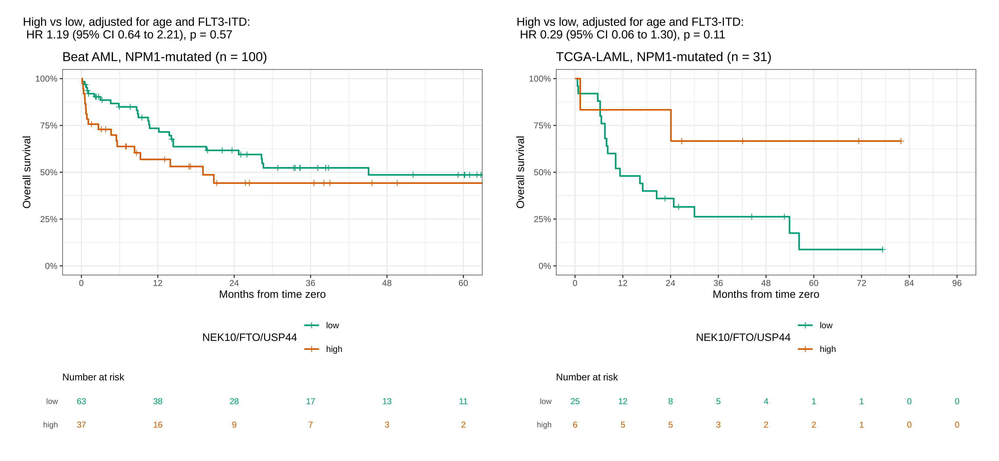

Inside NPM1-mutated AML, the NEK10/FTO/USP44-high (primitive-like) group did worse before adjustment in Beat AML (HR 1.58, 0.86 to 2.88), much of it from deaths in the first two months (9 of 37 vs 5 of 63) and from FLT3-ITD (51% vs 35%). Adjusted for age and FLT3-ITD the HR is 1.19 (0.64 to 2.21; 18 deaths in 37 high, 26 in 63 low). That leans the same way as Mer et al. (2021) but is far from conclusive: with 44 deaths the test has about 60% power for an HR of 2 and 25% for 1.5. In TCGA (31 patients, 22 deaths, only 2 in the 6 high cases) the point estimate goes the other way (HR 0.29, 0.06 to 1.30), which with these numbers tells us almost nothing.

### Predicting NPM1 status from a small gene panel

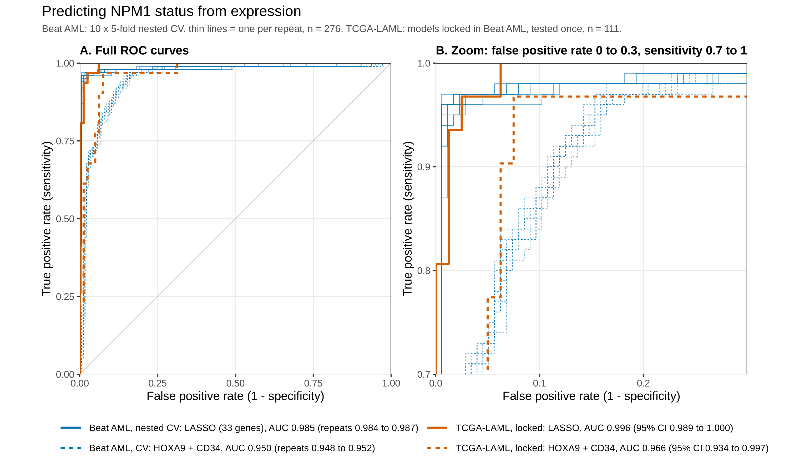

Can a small set of genes tell NPM1-mutated from wild-type AML, and does it work in a cohort it has never seen? A LASSO logistic regression on Beat AML expression keeps **33 genes** (14 higher and 19 lower in NPM1-mutated AML; the largest weights are HOXB-AS3, NPTX1, WNT7B, MIR503HG, HIPK2 and BAALC). **Blue, Beat AML:** nested cross-validation, one thin line per repeat (10 repeats of 5-fold CV, n = 276); every prediction comes from a model that never saw that patient, and the penalty was chosen inside each training set. The LASSO model scores **AUC 0.985** (range over repeats 0.984 to 0.987) and HOXA9 + CD34 alone 0.950. On its own training data the 33-gene model scores 0.9998, which is what overfitting looks like and why the cross-validated number is the honest one. **Orange, TCGA-LAML:** both models were locked in Beat AML and then tested once on 111 TCGA patients (31 NPM1-mutated), after TCGA counts were put through Beat AML's VST and each gene was rescaled to Beat AML's mean and SD. The LASSO model holds up: **AUC 0.996 (95% CI 0.989 to 1.000)**, 108 of 111 patients called correctly. Two of its three errors are the same wild-type patients that looked NPM1-like in the Session 7 signature score. HOXA9 + CD34 reach 0.966 (0.934 to 0.997) and 103 of 111 (paired DeLong p = 0.046 against the LASSO model). Five genes already give a cross-validated AUC of 0.976 and the gain flattens at about 10. Without the rescaling the AUCs barely move, but HOXA9 + CD34 misses 8 instead of 2 of the 31 NPM1-mutated patients, because CD34 runs about 1 VST unit higher in TCGA before rescaling. NPM1 has one of the strongest expression signatures in AML, so this shows the signal is easy to read and travels between cohorts; it isn't a substitute for the DNA test. Panel B zooms into the top-left corner, where all four curves sit.

## Interpretation

*To write: what the results mean for NPM1 biology and menin inhibitors.*

## Limitations

*To write: see the candidate list in LEARNING.md.*

## Next steps

*To write: see the candidate list in LEARNING.md.*

## How to reproduce

1. **Get R 4.6.1 and the packages.** There are two ways; use one.
   - *Exact versions, any system (renv).* `renv.lock` records the version of every R package used here (127 packages: Bioconductor 3.23 and CRAN). Install R 4.6.1, then from the repo root run:
     ```r
     install.packages("renv")
     renv::restore()
     ```
     renv asks whether to activate the project; say yes, so the scripts use the library it builds in `renv/library/`. On Linux most packages compile from source, so the first restore takes a while; renv caches them for next time.
   - *Fast, Ubuntu 24.04 only.* `bash setup/cloud_setup.sh` installs R and every package as prebuilt binaries from r2u (about 1 to 4 minutes). These are the newest r2u builds, so they can be newer than `renv.lock` over time. `Rscript setup/renv_snapshot.R --check` lists any package whose installed version differs from the lockfile.
   - After adding or updating a package, rewrite the lockfile with `Rscript setup/renv_snapshot.R`.
2. From the repo root, run the whole pipeline with `Rscript scripts/run_all.R`, or run the scripts one at a time in this order:

| Script | What it does | Main outputs |
|---|---|---|
| `scripts/01_download.R` | Downloads the Beat AML 2.0 files into `data/` and checks none is a Git LFS pointer | `data/` (not committed) |
| `scripts/02_cohort.R` | Builds the cohort | `results/cohort.csv`, `results/cohort_flow.csv` |
| `scripts/03_qc.R` | Low-count filter, library sizes, PCA, sex check | `results/qc_*.csv`, `figures/03_*.png` |
| `scripts/04_deseq2.R` | Main DESeq2 model and FLT3-ITD sensitivity model | `results/deseq2_npm1.csv`, `figures/04_*.png` |
| `scripts/05_enrichment.R` | GSEA, collapsed GO terms, three-group plot, NEK10/FTO/USP44 check | `results/gsea_*.csv`, `figures/05_*.png` |
| `scripts/06_subgroup.R` | Subgroup vs co-mutations and published NPM1 subtypes | `results/subgroup_*.csv`, `figures/06_subgroup_primitive_committed.png` |
| `scripts/06b_deseq2_subgroups.R` | Sensitivity DESeq2 with NPM1-high / NPM1-low | `results/deseq2_subgroups.csv`, `figures/06_subgroup_shared_vs_specific.png` |
| `scripts/07_cell_composition.R` | Malignant cell-type scores and cell-type sensitivity DESeq2 | `results/celltype_*.csv`, `results/deseq2_celltype_*.csv`, `figures/07_*.png` |
| `scripts/08_tcga_replication.R` | Replication in TCGA-LAML (downloads about 650 MB from GDC) | `results/tcga_*.csv`, `figures/08_*.png` |
| `scripts/09_drug_response.R` | Ex vivo drug response by NPM1 status, subgroup and HOX score | `results/drug_*.csv`, `figures/09_*.png` |
| `scripts/10_survival.R` | Exploratory overall survival: NPM1, NPM1 x FLT3-ITD, NEK10/FTO/USP44 group (Beat AML and TCGA) | `results/survival_*.csv`, `figures/10_*.png` |
| `scripts/11_fto_locus.R` | FTO vs IFEX9: read coverage and splice junctions along FTO in TCGA-LAML (recount3), plus FTO-locus genes in Beat AML | `results/fto_*.csv`, `figures/11_*.png` |
| `scripts/13_classifier.R` | LASSO NPM1 classifier: nested CV in Beat AML, model locked, one test in TCGA-LAML, HOXA9 + CD34 comparison (runs before 12, which copies its figure) | `results/classifier_*.csv`, `figures/13_classifier_roc.png` |
| `scripts/12_build_site.R` | Data files for the web page: per-gene quartiles by group (needs `data/` only if the CSV is missing), the gene lookup JSON, figure copies | `results/site_gene_group_quartiles.csv`, `docs/data/genes.json`, `docs/figures/` |

`run_all.R` runs each script in its own R process, stops at the first failure (resume with `Rscript scripts/run_all.R --from 08`, for example) and writes how long each script took to `results/run_all_timings.csv`. In Session 12 it ran from a fresh clone with every output deleted in **37.5 minutes** on a 4-core machine. About 60% of that is the two scripts that download TCGA data (08, about 650 MB from GDC; 11, the FTO slices from recount3), so it depends on how busy those servers are. Every result table came back identical to the committed one. Each script saves its `sessionInfo()` to `results/`.

## AI use

*To write: how AI tools were used in this project.*

## References

- Arza-Apalategi S, Heuts BMH, Dooijes MTM, et al. High expression of an intragenic long noncoding RNA misinterpreted as high FTO oncogene expression in NPM1 mutant acute myeloid leukemia. *Leukemia* 2023;37(4):901-904. https://doi.org/10.1038/s41375-023-01844-w
- Bottomly D, Long N, Schultz AR, et al. Integrative analysis of drug response and clinical outcome in acute myeloid leukemia. *Cancer Cell* 2022;40(8):850-864.e9. https://doi.org/10.1016/j.ccell.2022.07.002
- Cancer Genome Atlas Research Network. Genomic and epigenomic landscapes of adult de novo acute myeloid leukemia. *New England Journal of Medicine* 2013;368(22):2059-2074. https://doi.org/10.1056/NEJMoa1301689
- Döhner H, Wei AH, Appelbaum FR, et al. Diagnosis and management of AML in adults: 2022 recommendations from an international expert panel on behalf of the ELN. *Blood* 2022;140(12):1345-1377. https://doi.org/10.1182/blood.2022016867
- Mer AS, Heath EM, Madani Tonekaboni SA, et al. Biological and therapeutic implications of a unique subtype of NPM1 mutated AML. *Nature Communications* 2021;12(1):1054. https://doi.org/10.1038/s41467-021-21233-0
- Pei S, Pollyea DA, Gustafson A, et al. Monocytic subclones confer resistance to venetoclax-based therapy in patients with acute myeloid leukemia. *Cancer Discovery* 2020;10(4):536-551. https://doi.org/10.1158/2159-8290.CD-19-0710
- Schoenfeld DA. Sample-size formula for the proportional-hazards regression model. *Biometrics* 1983;39(2):499-503. https://doi.org/10.2307/2531021
- Tyner JW, Tognon CE, Bottomly D, et al. Functional genomic landscape of acute myeloid leukaemia. *Nature* 2018;562(7728):526-531. https://doi.org/10.1038/s41586-018-0623-z
- van Galen P, Hovestadt V, Wadsworth MH II, et al. Single-cell RNA-seq reveals AML hierarchies relevant to disease progression and immunity. *Cell* 2019;176(6):1265-1281.e24. https://doi.org/10.1016/j.cell.2019.01.031
- Verhaak RGW, Goudswaard CS, van Putten W, et al. Mutations in nucleophosmin (NPM1) in acute myeloid leukemia (AML): association with other gene abnormalities and previously established gene expression signatures and their favorable prognostic significance. *Blood* 2005;106(12):3747-3754. https://doi.org/10.1182/blood-2005-05-2168
- Wilks C, Zheng SC, Chen FY, et al. recount3: summaries and queries for large-scale RNA-seq expression and splicing. *Genome Biology* 2021;22(1):323. https://doi.org/10.1186/s13059-021-02533-6
- Zhang H, Nakauchi Y, Köhnke T, et al. Integrated analysis of patient samples identifies biomarkers for venetoclax efficacy and combination strategies in acute myeloid leukemia. *Nature Cancer* 2020;1(8):826-839. https://doi.org/10.1038/s43018-020-0103-x
