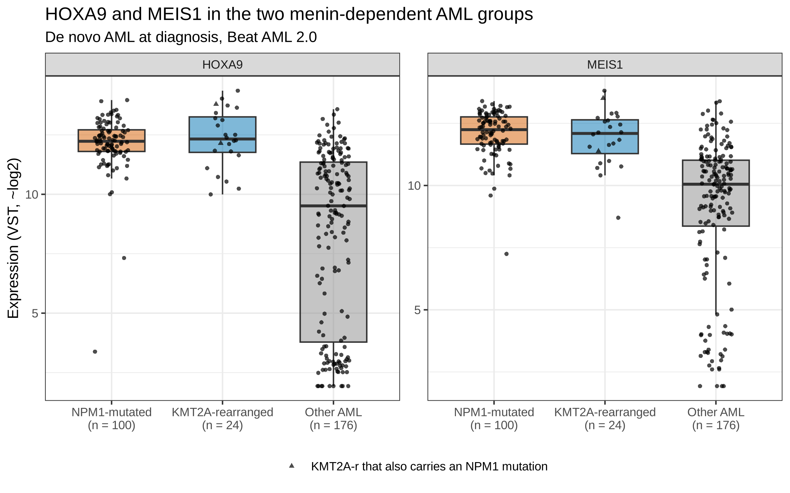
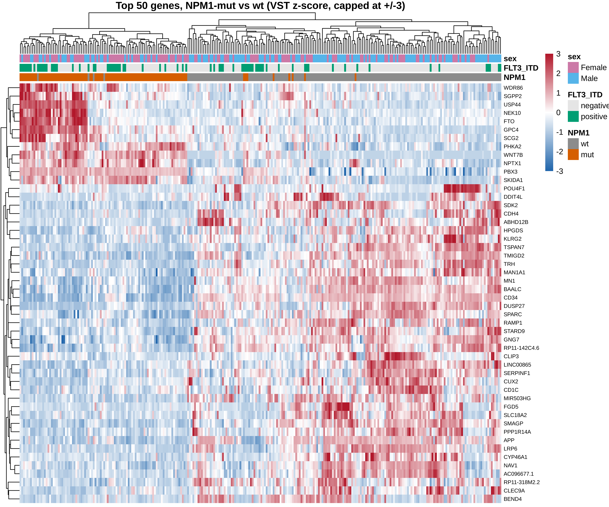
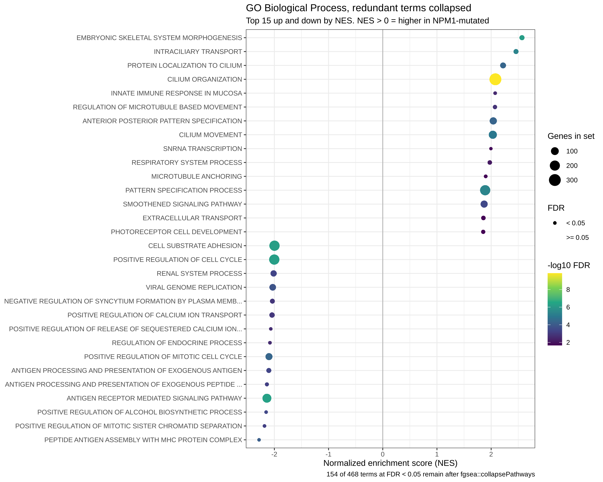
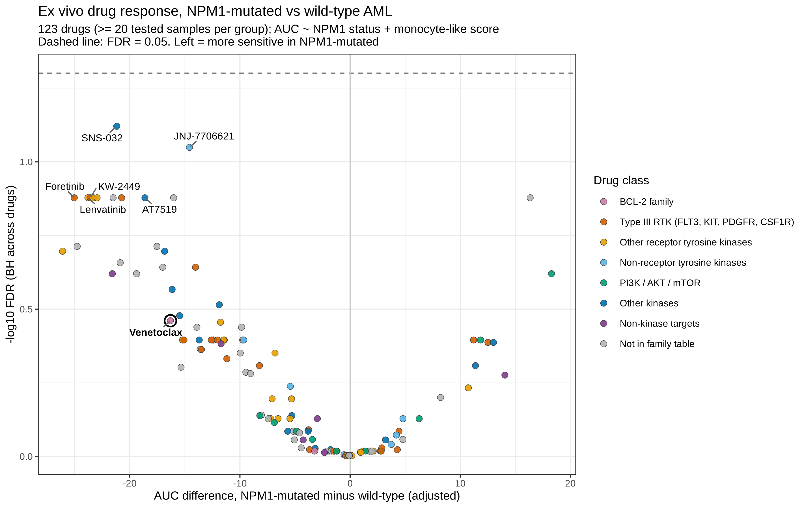

# Gene expression in NPM1-mutated vs NPM1-wild-type AML (Beat AML 2.0)

A learning and portfolio project: differential expression between NPM1-mutated and NPM1-wild-type acute myeloid leukaemia using Beat AML 2.0 RNA-seq counts, connected to menin inhibitor biology. The session-by-session log, with every number and decision, is in [LEARNING.md](LEARNING.md).

## Summary

*To write: three to five sentences on the question, the cohort, the main result and what it means.*

## Background

*To write: NPM1 mutations in AML, the HOX/MEIS1 program, and why menin inhibitors target it.*

## Question and hypothesis

*To write: the question this project asks and what we expected to see.*

## Data

All data come from **Beat AML 2.0** (https://github.com/biodev/beataml2.0_data), shared under the [Creative Commons Attribution 4.0 licence (CC-BY-4.0)](https://creativecommons.org/licenses/by/4.0/). The data are by the Beat AML investigators and are used here unchanged, apart from the filtering and analysis described below; this project is not endorsed by them. Raw data are not stored in this repository; `scripts/01_download.R` fetches them.

Files used:

| File | Used for |
|---|---|
| `beataml_waves1to4_counts_dbgap.txt` | Raw RNA-seq read counts per gene (Ensembl 75, GRCh37) |
| `beataml_wv1to4_clinical.xlsx` | Diagnosis, NPM1 and FLT3-ITD calls, specimen type, sex, wave, fusions |
| `beataml_waves1to4_sample_mapping.xlsx` | Matching RNA and DNA sample IDs to patients |
| `beataml_wes_wv1to4_mutations_dbgap.txt` | Exome mutation calls (co-mutations within NPM1-mutated AML) |

Please cite the Beat AML papers when using these data:

- Bottomly D, Long N, Schultz AR, et al. Integrative analysis of drug response and clinical outcome in acute myeloid leukemia. *Cancer Cell* 2022;40(8):850-864.e9. https://doi.org/10.1016/j.ccell.2022.07.002
- Pei S, Pollyea DA, Gustafson A, et al. Monocytic subclones confer resistance to venetoclax-based therapy in patients with acute myeloid leukemia. *Cancer Discovery* 2020;10(4):536-551. https://doi.org/10.1158/2159-8290.CD-19-0710
- Tyner JW, Tognon CE, Bottomly D, et al. Functional genomic landscape of acute myeloid leukaemia. *Nature* 2018;562(7728):526-531. https://doi.org/10.1038/s41586-018-0623-z

**Cohort.** AML only, sample taken at initial diagnosis, de novo AML only (no secondary or therapy-related AML), one sample per patient (the earliest). Acute promyelocytic leukaemia and KMT2A-fusion cases were excluded from the main comparison; the KMT2A-fusion cases are kept for a separate three-group plot. One sample was dropped in QC because its recorded sex didn't match its expression (possible sample swap). Final main cohort: **276 patients, 100 NPM1-mutated and 176 wild-type.** The step-by-step counts are in `results/cohort_flow.csv`.

## Methods

**Differential expression.** Genes with at least 10 reads in at least 100 samples were kept (19,398 genes). DESeq2 was fitted with the design `~ wave + specimen_type + sex + NPM1_status`, with NPM1 wild-type as the reference. `wave` is the Beat AML sequencing batch (three levels), `specimen_type` is bone marrow vs blood (leukapheresis counted as blood). Sex is in the model because NPM1-mutated AML is more common in women (64% vs 41% here). Fold changes were shrunk with apeglm; p-values come from the Wald test and were adjusted with Benjamini-Hochberg. A gene counts as changed at padj < 0.05 and |log2 fold change| > 1. A sensitivity model added FLT3-ITD to the design.

**Gene-set enrichment.** Genes were ranked by the DESeq2 Wald statistic. Male-specific chrY genes and XIST (26 genes) were removed first, because a sex-adjusted model still handles Y genes with near-zero counts in females badly. Preranked GSEA used fgsea (`fgseaMultilevel`, sets of 15 to 500 genes) on MSigDB Hallmark, GO Biological Process and the two Verhaak NPM1 sets (MSigDB 2026.1.Hs via msigdbr). FDR was corrected within each collection. Redundant GO terms were collapsed with `fgsea::collapsePathways`.

**Expression plots and subgroup analysis.** Expression values for plots are DESeq2 variance-stabilised (VST) counts. Within NPM1-mutated AML, a score from NEK10, FTO and USP44 (mean z-score) was split into two groups by k-means. The groups were compared with exome mutation calls, FLT3-ITD, and marker scores for the primitive and committed subtypes of Mer et al. (2021). A second sensitivity DESeq2 model replaced NPM1 status with a three-level group (wild-type, NPM1-high, NPM1-low): `~ wave + specimen_type + sex + group`.

**Software.** R 4.6.1 on Ubuntu 24.04. DESeq2 1.52.0, apeglm 1.34.0, fgsea 1.38.0, msigdbr 26.1.1 (MSigDB 2026.1.Hs), BiocParallel 1.46.0, data.table 1.18.6.1, dplyr 1.2.1, tidyr 1.3.2, readxl 1.6.0, jsonlite 2.0.0, ggplot2 4.0.3, ggrepel 0.9.8, pheatmap 1.0.13. Full `sessionInfo()` for each step is in `results/sessionInfo*.txt`. Random steps use seed 2026.

## Results

### NPM1-mutated and KMT2A-rearranged AML share high HOXA9 and MEIS1

HOXA9 and MEIS1 expression (VST, roughly log2) in de novo AML at diagnosis: NPM1-mutated (n = 100), KMT2A-rearranged (n = 24) and other AML (n = 176). Both menin-dependent groups sit at the same high level (median HOXA9 12.2 and 12.3, MEIS1 12.2 and 12.1), about 2 to 2.8 log2 units above other AML (Wilcoxon p < 1e-8). NPM1-mutated and KMT2A-rearranged don't differ (p = 0.42 and 0.40). Triangles are the two KMT2A-rearranged cases that also carry an NPM1 mutation. Some "other AML" cases are HOXA9-high too, without either lesion.

### Differential expression

Each point is one of 19,398 genes: shrunken log2 fold change (NPM1-mutated vs wild-type) against -log10 adjusted p-value. 1,019 genes pass padj < 0.05 and |log2FC| > 1: 307 up and 712 down in NPM1-mutated AML. The positive controls all go the expected way: HOXA9 (+1.6), HOXA10 (+1.5), HOXB2 to HOXB9 (+1.4 to +3.1), MEIS1 (+1.6) and PBX3 (+1.9) up; CD34 down (-4.0). The two most significant up genes are NEK10 and FTO. Adding FLT3-ITD to the model keeps 42 of the top 50 genes in the top 50 (fold-change correlation 0.98).

The 50 most significant genes (VST, scaled per gene) across all 276 samples, clustered by gene and by sample. NPM1-mutated samples fall almost entirely into one branch. FLT3-ITD and sex don't line up with the branches. Most top genes are lower in NPM1-mutated AML, many of them stem and progenitor genes such as CD34 and BAALC.

### The published NPM1 signature is reproduced

GSEA running enrichment score for VERHAAK_AML_WITH_NPM1_MUTATED_UP (174 genes in our list), a signature built from an independent microarray cohort in 2005. Most of the set sits at the top of our ranking: NES +3.31, FDR 2.4e-36. The matching DN set goes the other way (NES -3.76, FDR 1.4e-96). This is the strongest check that the pipeline works end to end.

### Pathways after collapsing redundant GO terms

Top 15 up and top 15 down GO Biological Process terms by NES, after `fgsea::collapsePathways` removed terms explained by a more significant overlapping term (468 terms at FDR < 0.05 down to 154). Up: embryonic skeletal morphogenesis and anterior/posterior pattern specification, whose leading edges are the HOXA and HOXB genes and PBX3, so this is the HOX program in GO's language. A group of cilium terms is also up, which we haven't explained yet. Down: antigen presentation (MHC class II) and cell-cycle terms. Dot size is genes in the set, colour is -log10 FDR.

### A known subgroup inside NPM1-mutated AML

About 40% of NPM1-mutated samples (37 of 100) have high NEK10, FTO and USP44 (two-cluster k-means on the mean z-score of the three genes; WDR86, an early fourth member, was dropped because it tracks FLT3-ITD instead). This group **matches two published NPM1 subgroups**; it is not a new discovery.

- **Mer et al. (2021), primitive vs committed subtypes.** Their primitive markers are all higher in our high group and their committed markers all lower.
- **Arza-Apalategi et al. (2023), IFEX9-high.** They showed that "high FTO" in about a third of NPM1-mutated AML is really an intragenic lncRNA, IFEX9, linked to FLT3-ITD, TET2, IDH2 and an immature profile. Our high group is enriched for TET2 (33% vs 11%) and IDH2 (39% vs 13%), leans towards FLT3-ITD (51% vs 35%, not significant), and holds 11 of the 15 samples with NPM1 + FLT3-ITD + TET2 or IDH2.
- **The "FTO" rise is IFEX9, not FTO itself** (TCGA-LAML read coverage, next section). Beat AML's gene-level counts can't separate the two: Ensembl 75 files IFEX9 as one of FTO's own transcripts (FTO-007, ENST00000472835), so its reads are counted as FTO.

Primitive score (mean z-score of CDH2, GPR12, MDFI, ZNF521, PLXNB1, HHIP) and committed score (CD163, C1QA, CD14, MARCO, MSR1), the marker genes of Mer et al. (2021), in the NEK10/FTO/USP44-low (n = 63) and -high (n = 37) groups. The high group is primitive-like (Wilcoxon p = 2e-16) and the low group committed-like (p = 9e-7). The primitive score correlates with the NEK10/FTO/USP44 score at 0.91, and 32 of 37 high samples look primitive. The markers come from a different cohort and were picked by a different group, which is why the match is meaningful, though both scores are measured on the same RNA-seq data.

Log2 fold change vs NPM1 wild-type for the primitive-like (y) and committed-like (x) subgroups, from a sensitivity DESeq2 model with a three-level group. Coloured points are the 1,019 main-model genes. HOXA9, HOXA10, MEIS1 and PBX3 are up and CD34 down in both subgroups (all padj < 1e-4), and the HOX genes sit near the diagonal: the HOX program is shared by NPM1-mutated AML as a whole. NEK10, USP44 and FTO rise only in the primitive-like group. Of the 1,019 genes, 521 change about equally in both subgroups, 381 mostly in the primitive-like group and 117 mostly in the committed-like group (one subgroup's fold change at least 2x the other's).

### Is it FTO, or a transcript inside FTO?

Read coverage along FTO (GRCh38, GENCODE v26, from recount3) in TCGA-LAML, scaled to 40 million 100-base reads: median of the 6 NPM1-mutated NEK10/FTO/USP44-high samples (orange, each sample also drawn thin), the 25 low samples (blue) and the 80 NPM1 wild-type samples (grey). FTO exons 1 to 8 look the same in all three groups. In the high group coverage jumps at IFEX9 exon 1, a small exon deep in FTO intron 8 (mean coverage 238 vs 4 in the low group; coordinates from Arza-Apalategi et al. 2023, checked against their qPCR primers), stays raised along the rest of intron 8, and lifts FTO exon 9 about 12-fold (81 vs 6.5). In every high sample, reads splice from IFEX9 exon 1 onto FTO exon 9 (61 to 434 reads per sample, vs at most 18 in the low samples), and onto several intron-8 acceptors that aren't in the annotation. The canonical FTO junctions (exon 1 to 2, ..., 8 to 9) are not higher in the high group. So the "high FTO" signal comes from a transcript that starts inside FTO and shares only its last exon: IFEX9, as Arza-Apalategi et al. reported. Exon 9 is also the part of FTO that gene-level counts are dominated by (10.2 of 11.4 kb of exon), which is why a gene-level count reads it as "FTO is up". Six high samples is a small group, so the per-sample plots (`figures/11_fto_coverage_per_sample.png`, `figures/11_fto_key_features.png`) matter as much as the tests: every one of the six shows the same pattern, and none of the 25 low samples does.

### Ex vivo drug response

Beat AML tested each sample's leukaemia cells against a drug panel and summarised each dose-response curve as an AUC (lower = more sensitive). Drug results were matched to the same specimen used for RNA-seq (211 of 276 main-cohort samples; 206 also have a monocyte-like score and form the analysis set). For each of 123 drugs with at least 20 tested samples per group, a linear model of AUC on NPM1 status plus the monocyte-like cell-type score gives the AUC difference (x) and a Benjamini-Hochberg FDR across drugs (y). No drug passes FDR 0.05; most of the leaning is towards NPM1-mutated cells being a bit more sensitive, led by kinase inhibitors (SNS-032, JNJ-7706621, FDR 0.08 to 0.09). No menin inhibitor (revumenib, ziftomenib or others) or DOT1L inhibitor is in the Beat AML panel, so the menin hypothesis can't be tested with these data.

Venetoclax (BCL-2 inhibitor). A: no clear difference between NPM1-mutated and wild-type samples (adjusted difference -16, FDR 0.35). B: venetoclax AUC rises steeply with the monocyte-like score in both groups (Spearman 0.64 and 0.79): monocytic AML cells rely on MCL-1 rather than BCL-2 and resist venetoclax (Pei et al. 2020; Zhang et al. 2020). C: inside NPM1-mutated AML, the primitive-like NEK10/FTO/USP44-high group is far more sensitive than the committed-like group (median AUC 65 vs 204, FDR 8e-6), and about half of that gap remains after adjusting for the monocyte-like score. Mer et al. (2021) linked the primitive subtype to sorafenib, sunitinib and quizartinib sensitivity in an earlier Beat AML release; here those three lean the same way at most weakly (FDR 0.32 to 0.99).

## Interpretation

*To write: what the results mean for NPM1 biology and menin inhibitors.*

## Limitations

*To write: see the candidate list in LEARNING.md.*

## Next steps

*To write: see the candidate list in LEARNING.md.*

## How to reproduce

1. Install R and the packages. On Ubuntu 24.04, `bash setup/cloud_setup.sh` installs R and every package as prebuilt binaries (about 2 to 4 minutes).
2. From the repo root, run the whole pipeline with `Rscript scripts/run_all.R`, or run the scripts one at a time in this order:

| Script | What it does | Main outputs |
|---|---|---|
| `scripts/01_download.R` | Downloads the Beat AML 2.0 files into `data/` and checks none is a Git LFS pointer | `data/` (not committed) |
| `scripts/02_cohort.R` | Builds the cohort | `results/cohort.csv`, `results/cohort_flow.csv` |
| `scripts/03_qc.R` | Low-count filter, library sizes, PCA, sex check | `results/qc_*.csv`, `figures/03_*.png` |
| `scripts/04_deseq2.R` | Main DESeq2 model and FLT3-ITD sensitivity model | `results/deseq2_npm1.csv`, `figures/04_*.png` |
| `scripts/05_enrichment.R` | GSEA, collapsed GO terms, three-group plot, NEK10/FTO/USP44 check | `results/gsea_*.csv`, `figures/05_*.png` |
| `scripts/06_subgroup.R` | Subgroup vs co-mutations and published NPM1 subtypes | `results/subgroup_*.csv`, `figures/06_subgroup_primitive_committed.png` |
| `scripts/06b_deseq2_subgroups.R` | Sensitivity DESeq2 with NPM1-high / NPM1-low | `results/deseq2_subgroups.csv`, `figures/06_subgroup_shared_vs_specific.png` |
| `scripts/07_cell_composition.R` | Malignant cell-type scores and cell-type sensitivity DESeq2 | `results/celltype_*.csv`, `results/deseq2_celltype_*.csv`, `figures/07_*.png` |
| `scripts/08_tcga_replication.R` | Replication in TCGA-LAML (downloads about 650 MB from GDC) | `results/tcga_*.csv`, `figures/08_*.png` |
| `scripts/09_drug_response.R` | Ex vivo drug response by NPM1 status, subgroup and HOX score | `results/drug_*.csv`, `figures/09_*.png` |
| `scripts/11_fto_locus.R` | FTO vs IFEX9: read coverage and splice junctions along FTO in TCGA-LAML (recount3), plus FTO-locus genes in Beat AML | `results/fto_*.csv`, `figures/11_*.png` |

The full run takes roughly 30 minutes plus download time. `run_all.R` hasn't yet been tested from a clean checkout. Each script saves its `sessionInfo()` to `results/`.

## AI use

*To write: how AI tools were used in this project.*

## References

- Arza-Apalategi S, Heuts BMH, Dooijes MTM, et al. High expression of an intragenic long noncoding RNA misinterpreted as high FTO oncogene expression in NPM1 mutant acute myeloid leukemia. *Leukemia* 2023;37(4):901-904. https://doi.org/10.1038/s41375-023-01844-w
- Bottomly D, Long N, Schultz AR, et al. Integrative analysis of drug response and clinical outcome in acute myeloid leukemia. *Cancer Cell* 2022;40(8):850-864.e9. https://doi.org/10.1016/j.ccell.2022.07.002
- Ley TJ, Miller C, Ding L, et al. Genomic and epigenomic landscapes of adult de novo acute myeloid leukemia. *New England Journal of Medicine* 2013;368(22):2059-2074. https://doi.org/10.1056/NEJMoa1301689
- Mer AS, Heath EM, Madani Tonekaboni SA, et al. Biological and therapeutic implications of a unique subtype of NPM1 mutated AML. *Nature Communications* 2021;12(1):1054. https://doi.org/10.1038/s41467-021-21233-0
- Pei S, Pollyea DA, Gustafson A, et al. Monocytic subclones confer resistance to venetoclax-based therapy in patients with acute myeloid leukemia. *Cancer Discovery* 2020;10(4):536-551. https://doi.org/10.1158/2159-8290.CD-19-0710
- Tyner JW, Tognon CE, Bottomly D, et al. Functional genomic landscape of acute myeloid leukaemia. *Nature* 2018;562(7728):526-531. https://doi.org/10.1038/s41586-018-0623-z
- Wilks C, Zheng SC, Chen FY, et al. recount3: summaries and queries for large-scale RNA-seq expression and splicing. *Genome Biology* 2021;22(1):323. https://doi.org/10.1186/s13059-021-02533-6
- Verhaak RGW, Goudswaard CS, van Putten W, et al. Mutations in nucleophosmin (NPM1) in acute myeloid leukemia (AML): association with other gene abnormalities and previously established gene expression signatures and their favorable prognostic significance. *Blood* 2005;106(12):3747-3754. https://doi.org/10.1182/blood-2005-05-2168
- Zhang H, Nakauchi Y, Köhnke T, et al. Integrated analysis of patient samples identifies biomarkers for venetoclax efficacy and combination strategies in acute myeloid leukemia. *Nature Cancer* 2020;1(8):826-839. https://doi.org/10.1038/s43018-020-0103-x
